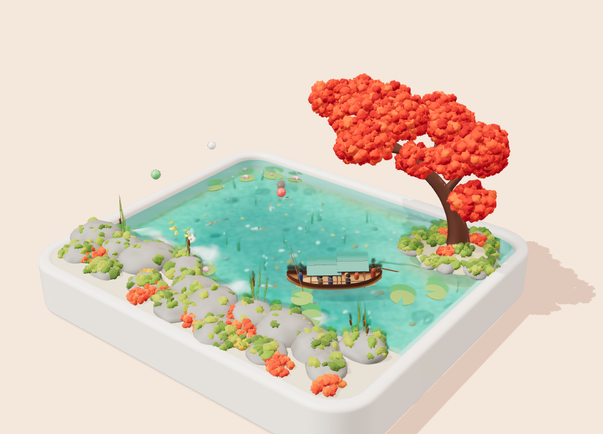

# 秋日果冻河 · Jelly River Diorama

A three.js miniature diorama: a ceramic tray holding a river, a rocky bank, a red maple tree
on a small island, and a little canopy boat. The river is a wobbly **jelly**, not water.



## Run

```bash
npm install
npm run dev      # http://localhost:5173
npm run build    # static build in dist/
npm run build:single  # one self-contained file: jelly-river.html
```

`jelly-river.html` is the whole scene in a single HTML file, with three.js inlined. Open it
straight from disk (no server needed).

## Interaction

| Action | Effect |
| --- | --- |
| Press and hold on the water | Push a dent into the jelly; release and it springs back and wobbles |
| Drag while pressing | Drag the dent around, leaving a jiggling trail |
| Double-click the water | Drop a ball that bounces on the jelly |
| 摇一摇 (Shake) | Shake the tray; the jelly sloshes with the container's acceleration |
| 丢小球 (Balls) | Drop three bouncy balls |
| 落叶 (Leaves) | A gust of maple leaves |
| Sliders | Jelly stiffness (弹性), damping (阻尼), and wave tension (张力) |
| Drag elsewhere / scroll | Orbit and zoom |

## How the jelly works

`src/jelly.js` simulates a height field on a 150×132 grid with a damped wave equation, plus an
elastic restoring force that pulls the surface back to rest:

```
dv/dt = tension·∇²h − stiffness·h − damping·v + viscosity·∇²v + forces
dh/dt = v
```

The `−stiffness·h` term makes it behave like jelly instead of water: dents spring back, overshoot,
and wobble in place while thick ripples spread outward. The resting surface is slightly domed, and
the material is a transmissive `MeshPhysicalMaterial` (clearcoat, sheen, a little iridescence,
and a tiling micro-ripple normal map) over a floor with animated caustics.

Objects on the surface (`src/floaters.js`) are held up by a stiff spring that depends on how far
they sink in, and push back down on the jelly with the same force. This is why heavy things leave
dents, dropped balls bounce, and everything bobs when you poke nearby.

## Scene contents

- **Boat** (`src/boat.js`): about 2.4 units long, scaled down from the reference. It has two
  canopies, seven passengers, a bow pole-man, and a stern rower whose oar strokes ripple the jelly.
  It cruises a loop, rides the jelly's height and tilt, and presses a moving wake into it.
- **On and in the water** (`src/life.js`): lily pads with lotus flowers and buds (anchored by their
  stems), a mother duck leading three ducklings, koi that swim under the jelly and sometimes rise
  to bump it from below, rising bubbles that pop as small bumps, swaying seaweed, coloured pebbles,
  maple leaves that fall from the tree and float, and bouncy balls.
- **Bank and island** (`src/bank.js`): grey boulders with moss caps, red and yellow flower
  cushions, cattails at the water's edge, and the island mound.
- **Tree** (`src/tree.js`): a tapered, curving trunk and branches, with clusters of red puffs for leaves.
