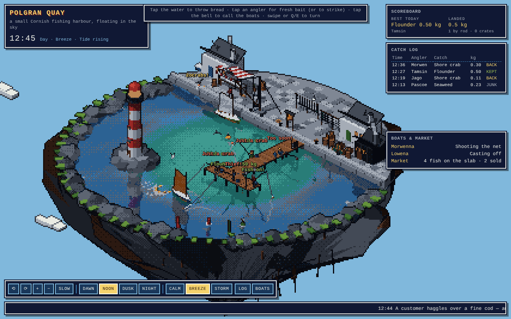
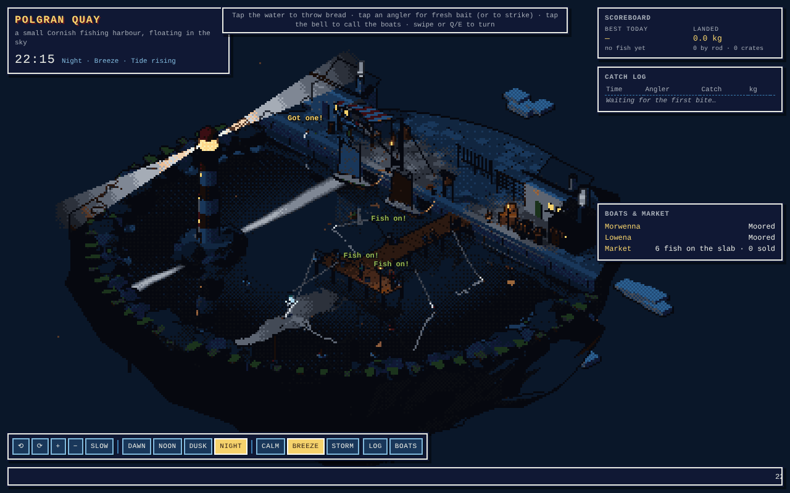

# Polgran Quay · 像素港



A small fishing harbour on a floating island, drawn as pixel art in three.js r160. It uses an
orthographic isometric camera with quarter turns, a low-resolution render target, depth-buffer
outlines, and nearest-colour mapping onto a 64-colour palette in OKLab (with a light Bayer dither).

**Single file:** [`polgran-quay.html`](./polgran-quay.html). three.js 0.160.0 comes from jsDelivr
through the page's import map, so the page needs an internet connection and WebGL 2.



## Develop

```bash
npm install                 # from the repository root
npm run dev:harbour         # http://localhost:4192 (uses the local three package)
npm run build:harbour       # rebuilds 像素港/polgran-quay.html; three stays on the CDN import map
```

## What's in it

| | |
| --- | --- |
| **The island** | A granite quay with whitewashed cottages, a smoking tar smokehouse, net racks, barrels, lobster pots, a fish market under a striped awning, a wooden derrick and the harbour bell. A ring of rocks holds the basin, with a red-and-white lighthouse whose two beams sweep the water at night. A T-headed wooden pier stands on tarred piles. |
| **Water** | A vertex grid lifted every frame by five long swells plus a slow tide (`env.js → seaHeight`). Boats, buoys, floats, nets, gulls and bread all use the same function. The water blends in a mirrored render of the scene, plus Fresnel, sun glint, crest foam, rain rings and the lighthouse beam. |
| **Anglers** | Five box-rigged anglers with two-bone IK limbs: two sit on the pier edge with legs dangling, one is on a stool, two stand. Each 8-segment rod bends toward the line's pull, and the line sags to a float. They cast along a parabola. Bites depend on species and time of day (mackerel, herring, bass, cod, flounder, conger, and also crab, boot and seaweed). A bite starts with nibbles, then the float is pulled under. Striking during the bite hooks the fish; striking too early or too late loses the bait. Fights have runs, rests, jumps and splashes, fish tire as they go, and big fish can snap the line. Landed fish are lifted, unhooked, weighed, then bucketed or released if undersized. |
| **Boats** | Two gaff-rigged luggers heel and sheet their sails to the wind, and their bow, stern and sides ride the swell. Each crew of two casts off, sails to the grounds, shoots and hauls a drift net full of flapping fish while gulls dive, then sails home and berths. The derrick lifts crates ashore one at a time, porters carry them to the market, customers buy fish, and the cat steals some. |
| **Life** | Gulls perch, soar, float on the swell, dive for bread and steal from buckets. A kid crabs off the quay wall. |
| **UI** | A scoreboard shows the best catch of the day and the total kg landed. There is also a catch log, boat and market status, a live ticker, and a chalkboard on the pier (drawn in a tiny bitmap font). |
| **Controls** | Tap the water to throw bread. Tap an angler for fresh bait, or to strike when they get a bite. Tap the bell to call the boats home (or send one out). ⟲ ⟳ / Q E / swipe to turn the view, +/− / wheel / pinch to zoom. SLOW, DAWN/NOON/DUSK/NIGHT, and CALM/BREEZE/STORM (rain, spray, lightning) are buttons in the control bar. The layout adapts to phones. |

## Source

`src/core.js` (pixel pipeline, camera), `palette.js`, `env.js` (clock, weather, sea height),
`water.js`, `world.js` + `kit.js` (merged static meshes), `people.js` (box rig + IK), `fishing.js`,
`harbour.js` (boats, nets, derrick, market, porters, customers, cat, kid, bell), `gulls.js`, `fx.js`,
`main.js`.
