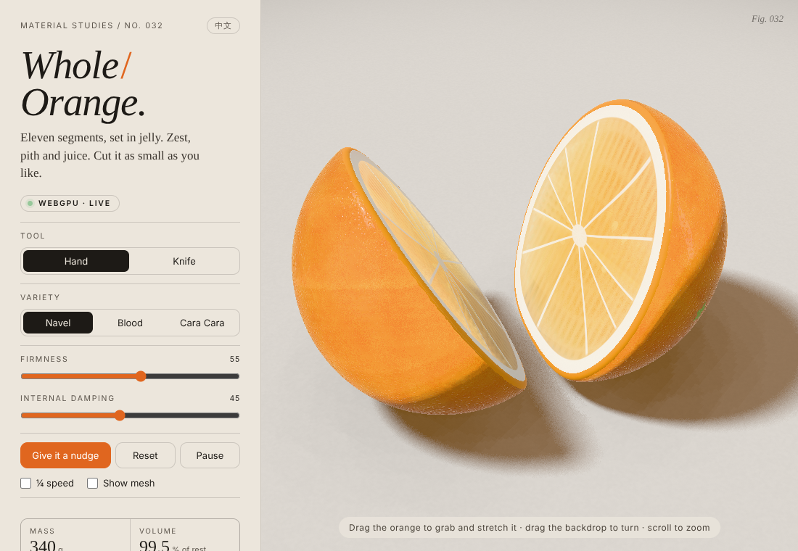

# Whole Orange Jelly · 切果冻橙子



*Material Studies / No. 032.* A real-time WebGPU soft-body orange made of jelly. You can grab it
and stretch it, and cut it with a knife into wheels, wedges and small pieces. Every piece is its
own wobbling body.

**Single-file build:** [`whole-orange-jelly.html`](./whole-orange-jelly.html) has all JS and CSS
inlined and uses no libraries. Open it in a browser with WebGPU (current Chrome or Edge, or
Safari Technology Preview). Browsers without WebGPU show a fallback page.

## Develop

```bash
npm install                 # from the repository root
npm run dev:orange          # http://localhost:4190
npm run build:orange        # rebuilds 切果冻橙子/whole-orange-jelly.html
```

## Controls

| | |
| --- | --- |
| **Hand** | Drag the orange to grab and stretch it. Drag the backdrop to orbit, and scroll to zoom. |
| **Knife** | Draw a stroke across the orange. The knife hovers where it will fall, lines up, presses a groove and cuts straight down. Right-drag orbits the camera. |
| Varieties | Navel, Blood, Cara Cara |
| Sliders | Firmness, Internal damping |
| Buttons | Give it a nudge, Reset, Pause; ¼ speed, Show mesh (the simulation lattice) |
| Readouts | Mass (g, 1 unit ≈ 3 cm at 1.3 g/cm³), Volume (% of rest), Kinetic (mJ), Pieces |
| EN / 中文 | Switch the interface language |

## How it works

| File | What it does |
| --- | --- |
| `src/orange.js` | The SDF: an oblate ellipsoid (polar half-length 1.27 on x, equatorial radius 1.36) with a softly flattened seat. Each piece is clipped by its half-spaces `n·X ≤ c`, and fresh edges are rounded with a smooth max (k = 0.085). Also holds the seeded anatomy (11 walls, 16 pips, bubbles) and the variety colours. |
| `src/mesher.js` | Per piece: a surface-nets skin on a 0.042 grid projected onto the field, and a hex lattice in the piece's principal frame with boundary nodes snapped to the surface. Render vertices are embedded barycentrically in the lattice tets. It runs as a generator, so a cut builds across several frames. Slivers are rejected. |
| `src/physics.js` | XPBD at a fixed 60 Hz with 5 substeps. Co-rotational shape matching per hex cell (mass-weighted, so momentum is conserved) and volume constraints on its 5 tets. Zest and pith are 2.6× firmer. Edge and deformation damping, floor contact with Coulomb friction, rolling resistance, and piece–piece contact against the other piece's exact rest SDF in its best-fit frame. Pieces sleep when still and wake on touch. |
| `src/knife.js` | A nakiri mesh and the cut sequence. The stroke is read on the top of what it crosses. It fixes a vertical blade plane, which is carried into each crossed piece's rest frame by that piece's best-fit rotation. The halves build while the knife lines up and presses, inherit the parent's positions and velocities, and are wedged apart by the blade. A pip that the cut goes through stays with the side holding its centre and is eased under the new face. |
| `src/shaders.js` | WGSL for every pass: PCSS key shadow tinted by the jelly, contact AO from a top-down height map, back-face thickness, refraction where each tap is dimmed by its own path, and a volumetric march in rest space using a per-vertex inverse deformation gradient. Absorption is per material (Beer–Lambert); scattering is grey. Also crisp cut faces (pith, membrane star, core), back-lit glow at thin edges, Fresnel studio reflections, GGX highlights, sugar glints, then Khronos PBR Neutral tone mapping, sRGB and dither. |
| `src/renderer.js` | WebGPU pipelines and render targets. |
| `src/main.js`, `src/i18n.js`, `index.html` | Camera, input, UI, dynamic resolution, and English/Chinese strings. |
