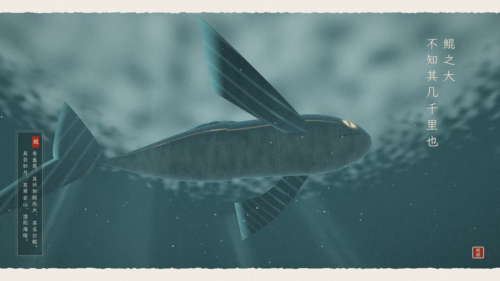
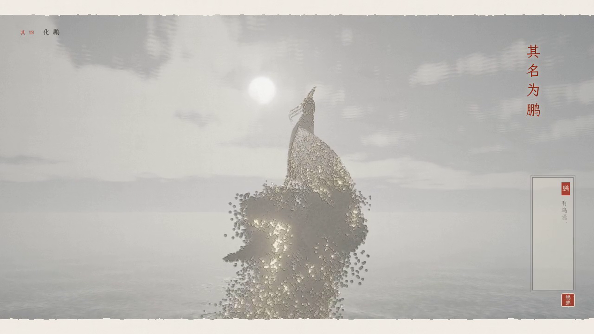
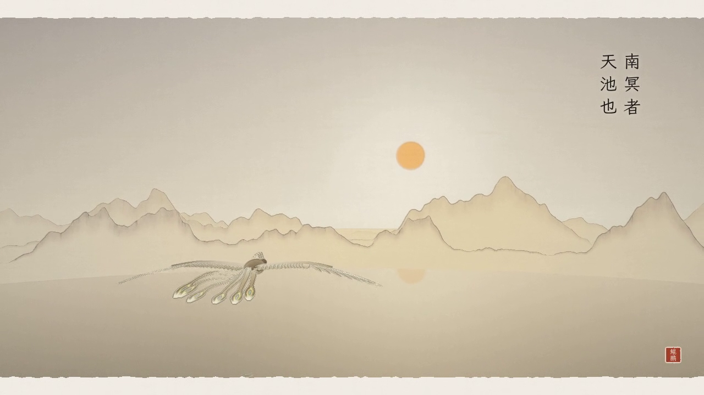

# 北冥有鱼



一段约 86 秒、可循环播放的水墨动画，取意《庄子·逍遥游》的开篇，旁注拟《山海经》的笔法。
鲲自北冥深处游来，出海、化鹏，乘扶摇直上九万里，向南冥天池飞去。

- **单文件：** [`beiming.html`](./beiming.html)。three.js、全部着色器和字体子集都内嵌在里面，离线也能打开（需要 WebGL 2）。
- **视频：** 在本地用同一个页面逐帧渲染成 1280×720 / 24fps 的 MP4，见下方「导出视频」。




## 六章

| 时间 | 章 | 画面 |
| --- | --- | --- |
| 0:00 | 题 · 北冥有鱼 | 宣纸上的题签。一滴墨落下、晕开，晕开处就是北冥。 |
| 0:06 | 其一 · 北冥 | 玄色深海，海雪与天光。远处有月亮一样的东西在动，那是鲲的眼睛。 |
| 0:16 | 其二 · 鲲 | 鲲目如月，从镜头前缓缓经过；再从极深处仰望，鲲背若山，压住了整片天光。 |
| 0:30 | 其三 · 海运 | 鲲转身上浮，镜头先一步破水而出，鲲随即跃出海面，水击如冠。 |
| 0:40 | 其四 · 化鹏 | 鲲在半空自首至尾散为墨点与金屑，墨点旋回聚拢，从身躯到翼尖化成鹏。 |
| 0:50 | 其五 · 扶摇 | 鹏乘旋风盘旋而上，穿过云海，云上远山如墨。 |
| 1:04 | 其六 · 南冥 | 鹏在云海之上南飞，朱日低悬，云开处是金色的天池。 |
| 1:18 | 跋 · 逍遥 | 画面褪回宣纸，留「逍遥游」与印。 |

## 操作

点「开卷」开始播放（带声音）。之后移动鼠标或轻触屏幕会出现控制条：

- 播放 / 暂停（空格）、重播、拖动进度条，进度条上方是各章节的跳转点
- `←` / `→` 后退 / 前进 5 秒，`1`–`8` 直接跳到对应章节
- `M` 静音，`F` 全屏

整段动画是时间 *t* 的纯函数：同一个 *t* 总是得到同一帧，所以可以随意拖动，循环播放时也不会累积误差。

## 怎么做的

| | |
| --- | --- |
| **鲲** (`src/kun.js`) | 身体、长鳍、背鳍和新月形尾在「脊柱空间」中建模。每帧 CPU 先沿头部轨迹按弧长解出 64 个脊柱节点（平行移动的上方向、翻滚、向尾部传递的摆动波），顶点着色器 `kunWorld()` 再把网格弯到脊柱上。片元着色器负责笔触纹理、鳞纹和向尾部流动的微光、金色侧线、焦散、出水后的湿亮，以及那只月亮似的眼睛。化鹏时按「从头到尾」的阈值逐片消散。 |
| **鹏** (`src/peng.js`) | 由羽片条带拼成：覆羽、次级飞羽、从腕部展开的初级飞羽、冠羽和带金色眼斑的长尾羽。振翅、收翼、尾羽摆动都在顶点着色器里完成（`pengDeform()`），振翅相位是振翅频率对时间的积分，所以拖动进度也能连贯。 |
| **化而为鸟** (`src/particles.js`) | 约 9 万个粒子：每个粒子取鲲表面一点和鹏表面一点，按「鲲的头 → 鹏的身」「鲲的尾 → 鹏的翼尖」排序配对。粒子在着色器里同时求出两端当前的位置（`kunWorld` 和 `pengDeform`），沿带卷曲噪声的弧线飞过去。另有出水的水花和扶摇的风痕。 |
| **天地** (`src/env.js`) | 天穹（风暴里的白日、云上的朱日）、跟随相机的极坐标海面（五组涌浪和破水的环形波）、水下的斯涅尔窗、光柱、海雪；十二层叠起来的云海（风眼处被旋风打穿，南面敞开露出天池）；三层环形远山，用皴笔纹理和留白的雾气画成。 |
| **镜头与调色** (`src/camera.js`, `src/grade.js`) | 八个镜头，切换处有短暂的墨色或纸色闪切。雾、天色、日光从深海的玄青渐变到风暴的灰白，再到云上的金色。 |
| **成纸** (`src/post.js`) | Bloom 之后用一个合成 pass 做 ACES 色调映射、按亮度变化描墨线、宣纸纤维与纸纹、四周压暗、开场的落墨晕染、结尾画面沉回纸中、带毛边的裱边和胶片颗粒。 |
| **题字** (`src/overlay.js`) | 竖排、从右至左的逍遥游原文，逐字由虚到实地显现；仿《山海经》体例的小注框；章节名；「鲲鹏」朱印。字体是霞鹜文楷（SIL OFL 1.1），由 `tools/font.py` 只截取用到的 147 个字，内嵌约 65 KB。 |
| **配乐** (`src/audio.js`) | 全部用 Web Audio 实时合成，同样是时间的函数：深海低音、鲸歌般的长滑音、水声与破水的轰鸣、扶摇的风声、鹏振翅的闷响、每句字幕出现时的古琴拨弦（D 宫调）和三声磬。播放、拖动、静音时按当前时间重排。导出视频时用同一份乐谱离线渲染成 WAV。 |

## 开发

```bash
npm install               # 在仓库根目录
npm run dev:beiming       # http://localhost:4193
npm run build:beiming     # 重新生成 北冥有鱼/beiming.html
```

改动了字幕或界面里的汉字之后，重新生成字体子集（需要 `pip install fonttools brotli`，以及 npm 包 `lxgw-wenkai-webfont` 解包后的目录）：

```bash
python3 -I 北冥有鱼/tools/font.py <lxgw-wenkai-webfont 包目录>
```

## 导出视频

页面在 `window.__CAPTURE__ = true` 时不显示开场和控制条，并提供 `window.__app.renderAt(t)` 和 `window.__app.renderAudio()`（返回 WAV 的 base64）。用 Playwright 逐帧调用 `renderAt(i / 24)` 并截图，把截图流交给 ffmpeg 编码，再与 `renderAudio()` 的音轨合并即可。截图包含 HTML 字幕层，所以字幕会一起进入视频。
