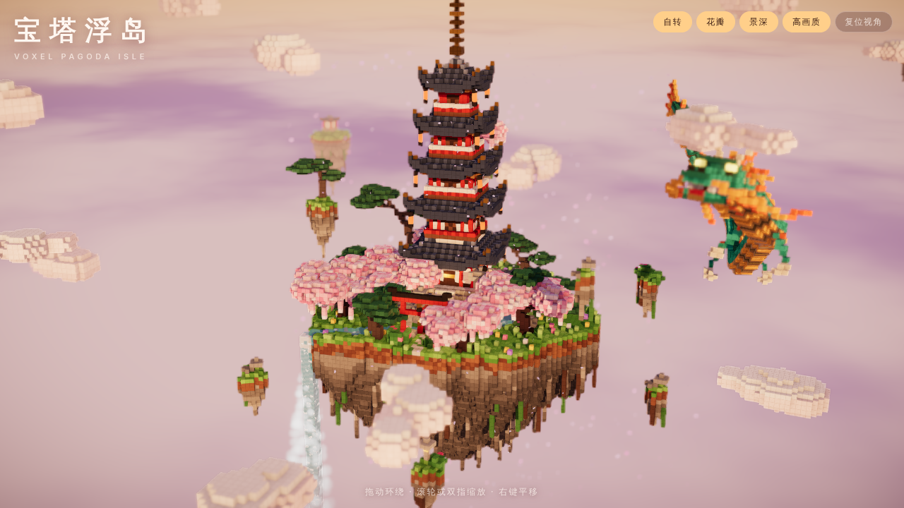
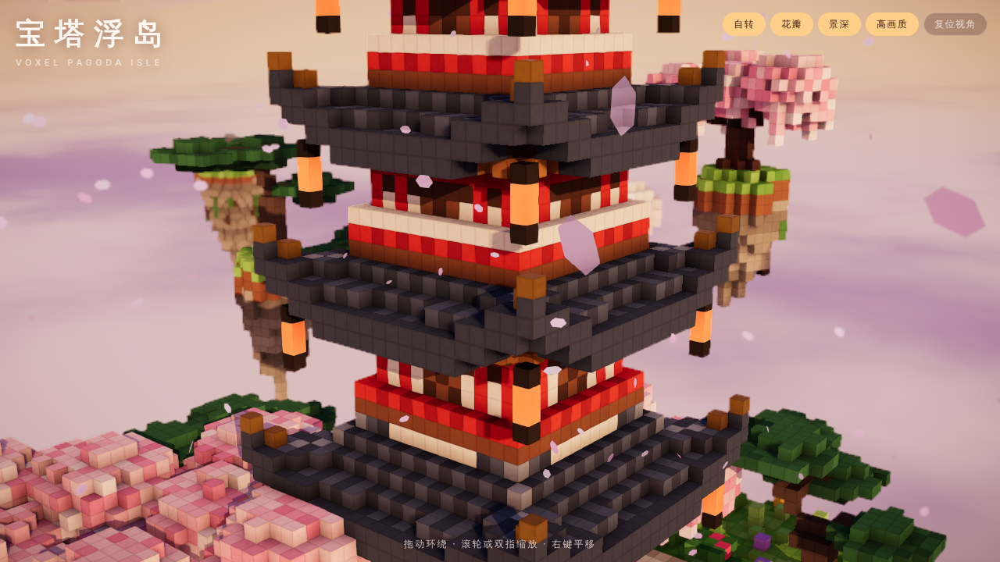

# 宝塔浮岛 · Voxel Pagoda Isle



用 Three.js 和 React（react-three-fiber）搭建的体素微缩浮岛：五重塔、樱花、黑松、太鼓桥、石板路、瀑布，一条神龙绕岛盘旋，四周是浮石、云朵和远处的小岛，笼罩在日落的金粉色光里。

- **单文件：** [`pagoda-island.html`](./pagoda-island.html)。React、three.js、react-three-fiber 和后期处理全部内嵌，离线可开（需要 WebGL 2）。
- 岛屿缓慢自转；拖动环绕、滚轮或双指缩放、右键平移。松手几秒后自转继续。
- 右上角可开关自转、花瓣、景深，切换「高画质 / 流畅」，或复位视角。手机默认「流畅」。



## 岛上有什么

| | |
| --- | --- |
| **地形** | 倒锥形的浮岛：草皮、土层、分层的岩石，底部垂着根须和藤蔓。岛顶分三级：前方草地、中央五重塔台地（石砌挡土墙）、后方松树山丘和泉池平台。 |
| **五重塔** | 石砌须弥座，五层逐级收分的塔身：朱红立柱、白壁、木格窗，首层有门。屋面先缓后陡，四角上翘，有瓦垄、垂脊、出檐和檐下椽木；每层四角挂着纸灯笼，上四层有平座栏杆，塔顶是露盘、九轮、水烟和宝珠。 |
| **水** | 泉池的水经几级小跌水，从太鼓桥下流过，在左前方漫过崖边成为瀑布，一直落入岛下的天空，边落边散成水雾。 |
| **路与小品** | 鸟居、石板路（苔藓长进石缝）、登上台地的台阶、红色太鼓桥、六座石灯笼。 |
| **植物** | 樱花树（分枝的树干、几种粉色的花团、下垂的花枝）、造型黑松（扭曲的树干和云片状的松针）、开着杜鹃的灌木、草丛和小花。 |
| **天空** | 一条翡翠色、金腹、橙鬃的神龙绕岛盘旋，身体上有波浪起伏；七块随岛漂浮的小岩石，十四朵体素云，五座远处的小岛（神社、樱花、松树、石灯笼）；脚下是日落的云海。 |

## 怎么做的

| 文件 | |
| --- | --- |
| `src/voxel.js` | 一个小型体素引擎：稠密网格加网格生成器。只为外露的面出几何，每个顶点按周围三个体素烘焙环境光遮蔽（并按遮蔽翻转四边形对角线），按材质分组输出（实体、摇曳枝叶、发光、金饰、水）。会摇摆的枝叶和静止体素之间的面不剔除，摇起来也不会露缝。 |
| `src/world/` | 用规则和种子生成一切：`island.js`（地形、溪流、路、桥、鸟居、石灯笼）、`pagoda.js`、`flora.js`、`dragon.js`、`extras.js`（云、浮石、远岛）。整座岛约五万个可见面，生成和网格化不到半秒。 |
| `src/scene/materials.js` | 在 three.js 标准材质上打补丁：每个面边缘微微压暗、面内有 4×4 的细颗粒，近看能看清每一块体素；枝叶在顶点着色器里摇摆，阴影也一起摇；灯笼发光并轻微闪烁；水面有流动的白色水纹，瀑布落到岛下后逐渐消散。 |
| `src/scene/` | 天空和云海（同时生成环境贴图，照亮金饰和水面）、岛屿与浮石、神龙（46 节身体沿环形路径飞行）、无状态的飘落花瓣、瀑布水雾、云与远岛。 |
| `src/scene/Effects.jsx` | N8AO 屏幕空间环境光遮蔽、跟随视点焦点的景深、细腻泛光、暗角、ACES 色调映射、SMAA；配合 PCSS 软阴影。 |

## 开发

```bash
npm install              # 在仓库根目录
npm run dev:pagoda       # http://localhost:4195
npm run build:pagoda     # 重新生成 宝塔岛/pagoda-island.html
```
