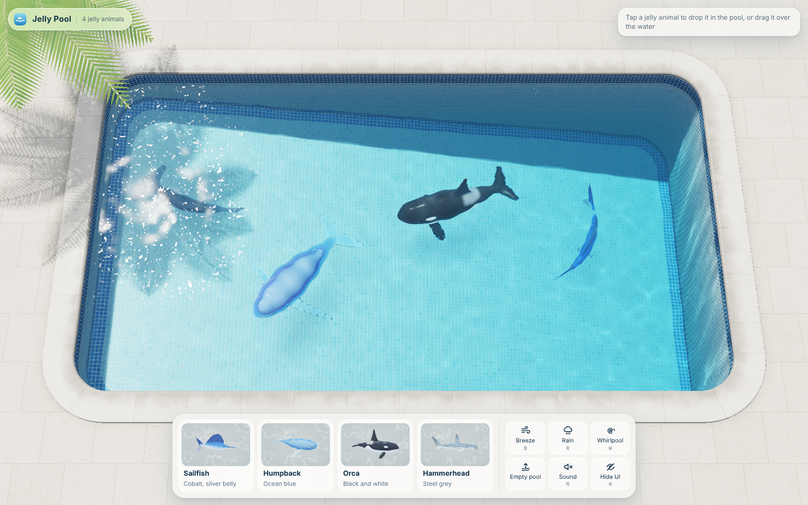
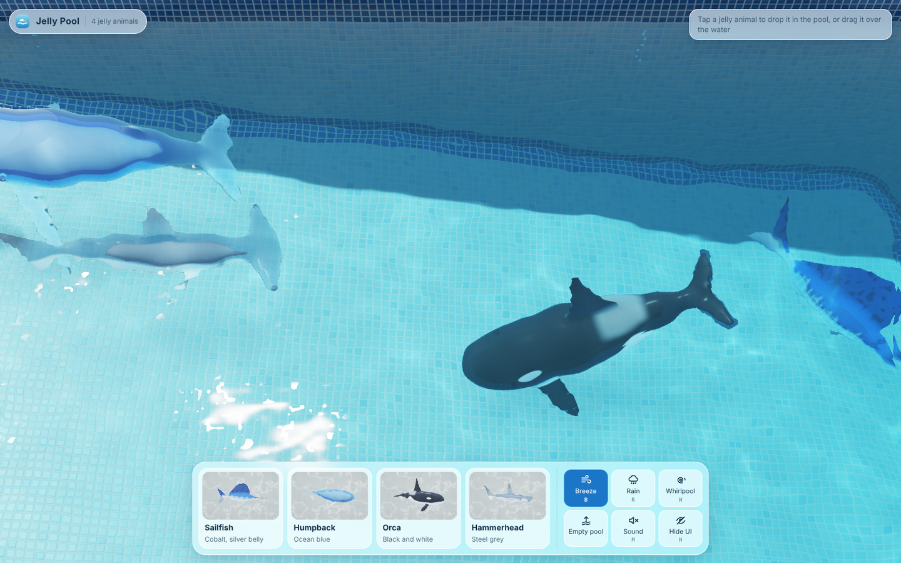

# Jelly Pool · 果冻泳池

A sunlit outdoor pool in real-time 3D. You drop soft jelly sea animals into it: a sailfish, a
humpback whale, an orca and a hammerhead shark. Each animal is clear, wobbly jelly that refracts
the pool behind it, with a milky core and dark glossy eyes. They splash in, dive, and swim with a
wave that travels down the body. Whales come up to breathe and blow a puff of mist.

Everything is procedural: no images, models or sound files. The interface is in English.

**One file:** [`jelly-pool.html`](./jelly-pool.html). It loads three.js r128 from cdnjs, so open it in a
browser with an internet connection. It needs WebGL 2 with float render targets (current Chrome, Edge,
Firefox or Safari). Browsers without WebGL 2 show a fallback card.

## Play

| | |
| --- | --- |
| Tap a card | Drops that animal into the pool from just above the water. |
| Drag a card | The animal hangs above the water under your pointer, wobbling. Let go and it falls in from there. Let go over the dock and it goes back to its card. |
| Drag an animal in the pool | Picks it up out of the water. Let go to drop or throw it. |
| Tap or drag the water | Makes ripples. |
| **B** Breeze | Wind ripples from a rolling noise gradient. The palm sways more. |
| **R** Rain | Random drop impacts, small ring ripples and a rain hiss. |
| **W** Whirlpool | A vortex turns the water and the animals. It has a darker funnel centre and spiral foam arms. |
| Empty pool | The animals rise out of the water, melt and fly back into their cards. |
| **M** Sound | Synthesised Web Audio, off by default: lapping, splashes and plops (louder for harder impacts), rain, the whale's blow, breeze. |
| **H** Hide UI | Hides the dock and labels. **Show UI** (or **H** / **Esc**) brings them back. |
| **1**–**4** | Drop a sailfish, humpback, orca or hammerhead. |

The pool holds 8 animals, or 6 on touch devices and machines with 4 or fewer cores. Those devices also
use a coarser jelly lattice. When the pool is full, a note says so.

## How it works

Everything is in one HTML file. The physics worker's source sits in a `<script type="text/plain">` tag.

| Part | What it does |
| --- | --- |
| Species | Each animal is a signed distance field: round-cone chains and ellipsoids joined with smooth unions, plus flat fins (2D outlines extruded thin, with rounded edges). The sailfish has a long bill, a tall sail and a forked tail. The humpback has long knobbly pectorals, throat pleats, a mouth line and head tubercles. The orca has a tall dorsal fin and a rounded head. The hammerhead has a wide cephalofoil, a tall dorsal fin and five gill slits. |
| Build | Voxel cells that touch the body are split into 5 tetrahedra (alternating, so faces match). Surface nets mesh the skin, the milky core (an inset of the trunk SDF) and the two eye beads. Then 2 passes of Laplacian smoothing run. Every render vertex is stored as its containing tetrahedron plus barycentric weights. |
| Physics | Runs in `hardwareConcurrency − 1` workers (1–3), made from a Blob URL. Each new animal goes to the least loaded worker. XPBD with small substeps does co-rotational shape matching per tetrahedron, with rotations warm-started from the last frame. Edge-based viscosity damps the wobble, and the core is stiffer than the skin. Under water (y < 0) there's no gravity and there's quadratic drag against the whirlpool and circulation flow. Above water, gravity applies. |
| Swimming | A soft hold constraint pulls the chest and head nodes (never fins or tail) towards a swim frame that the main thread moves. A travelling strain wave stretches and squeezes the tetrahedra on either side of the spine, down towards the tail: side to side for the fish, up and down for the whales. Turns bend the wave towards the turn. |
| Worker output | Each step, every node gets its position and the cofactor matrix of F = Ds·Dm⁻¹ (columns f1×f2, f2×f0, f0×f1), averaged over the tetrahedra around it. These are packed as four RGBA texels per node and returned as a transferable `Float32Array`. The worker also returns stats: centre of mass, water-surface crossings and key points. The main thread uses them for splashes, wakes and grabbing. |
| Skinning | The node data goes up as a float `DataTexture` each frame. The vertex shader `texelFetch`es the 4 nodes, blends positions with the barycentric weights and turns the rest normal with the blended cofactor matrix. |
| Water | A GPU height field on ping-pong float targets: a damped wave equation with the walls as boundaries. It also has slow advection from return jets, a whirlpool funnel, breeze forcing, and splash and touch impulses. A foam channel decays over time. |
| Caustics | A grid of sun rays is refracted through the height field onto the sloped floor plane. Brightness is the ratio of each cell's area with flat water to its area with the real surface. The rays carry the coping and palm shadows. The texture lights the pool shell and every underwater object. |
| Passes | 1. Opaque (half-float, view depth in alpha): deck, coping, mosaic shell, palm, bubbles, and the animals' cores and eyes, lit by caustic sunlight. 2. Jelly back faces: linear view depth. 3. Jelly front faces: thickness, Beer–Lambert tint per species, refraction of pass 1, Fresnel sky reflection, sun highlights, and a soft glow where sunlight passes through thin fins. 4. Soft, pale floor shadows per animal, darker under the core. 5. Water composite: a ray–height-field hit per pixel, wave refraction, depth-tinted water (bluer and darker at the deep end), Fresnel reflection of the sky, coping and tiled band, sun sparkles, meniscus, coping shadow and foam. |
| Patterns | Patterns live in rest space, so they move with the wobble. Each one is a filter film on the back, not paint. Sailfish: a cobalt back with a wavy edge, a silver belly, vertical stripes that glow brighter when it's excited (and soften at a distance), dark fins and a dark upper bill. Humpback: no pigment, only pleat and mouth-line grooves. Orca: black above the white line and on all fins, with a white eye patch and a grey saddle. Hammerhead: a steel-grey cape over the back and the top of the hammer, dusky fin tips, and gill slits. |
| Behaviour | A steering field (an SDF) marks where an animal can swim and still be seen. It covers the inside of the walls, but not the band hidden under the near coping (wider the deeper the animal swims) or the water under the card dock. It's biased towards the open middle. The centre, snout and tail are all kept inside. Animals wander in depth and steer apart, with a direct push so no two share the same water. Whales surface, break the surface with their backs and blow. |
| Quality | The internal resolution drops when frames get slow and comes back when they're fast again. |

### Development flags

`?quality=high` or `?quality=low` forces the lattice and animal cap. `?fixed` turns off adaptive
resolution. `?cam=x,y,z,tx,ty,tz` overrides the camera.
