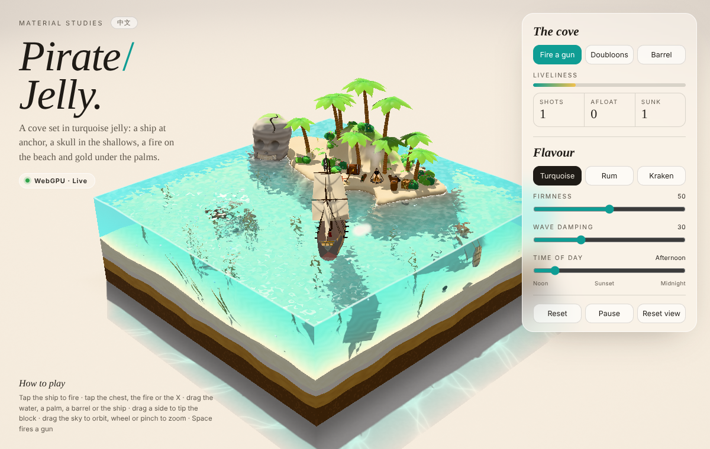
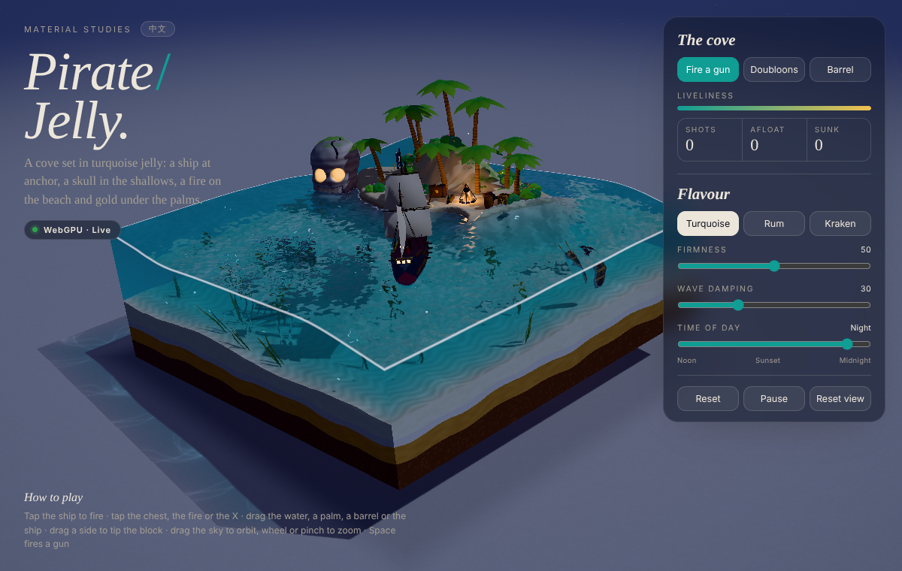

# Pirate Jelly · 海盗果冻岛屿



*Material Studies.* A square block of translucent jelly sea standing on a paper studio floor.
It holds a tropical island with a skull rock, a pirate ship at anchor, a beach camp and an old
wreck on the floor. Everything is built procedurally in WebGPU/WGSL, with no models, textures,
fonts or libraries. The page has an English and Chinese interface.

**Single-file build:** [`pirate-jelly.html`](./pirate-jelly.html). Open it in a browser with
WebGPU (current Chrome or Edge, or Safari with WebGPU enabled). Browsers without WebGPU show a
fallback card.



## Develop

```bash
npm install                 # from the repository root
npm run dev:pirate          # http://localhost:4191
npm run build:pirate        # rebuilds 海盗果冻岛屿/pirate-jelly.html
```

## Play

| | |
| --- | --- |
| Tap the ship / **Space** / *Fire a gun* | Fires the next gun on the broadside facing you. You get a ball, a muzzle flash, smoke and a recoil heel. |
| Drag the ship | Tows her against the anchor rode. Let go and she drifts back. |
| Tap the chest / the fire / the X | The lid swings with a bounce and the gold glitters. The fire roars and throws sparks. Three doubloons pop out of the sand. |
| Drag the water / a side of the block | Makes waves. Dragging a side tips the block, so the sea sloshes and the jelly wobbles. |
| Drag a ball, barrel or coin / a palm | Picks it up and throws it. Dragging a palm bends it. |
| Drag empty space, right-drag, wheel, pinch | Orbits and zooms the camera. |
| Panel | *Doubloons*, *Barrel*, liveliness meter, a Shots · Afloat · Sunk tally; Turquoise / Rum / Kraken jelly; Firmness, Wave damping, Time of day (Noon → Midnight); Reset / Pause / Reset view. |

## How it is built

| File | What it does |
| --- | --- |
| `src/world.js` | Layout in block-local units (block 5.2 × 5.2, still water at 1.55). Holds the island and cove height field, sea floor, prop positions, and the skull-rock SDF: cranium, cheekbones, jaw, deep sockets, heart nose, carved grin, crown crack, strata and noise, and a rock column to the floor. |
| `src/builder.js`, `src/geometry.js` | One procedural vertex/index buffer. Contains terrain, candy-strata cut faces, the skull (surface nets with cavity occlusion and an eye-glow mask) and its box teeth, palms, bushes, ferns, grass, rocks, the ship, the camp, the wreck, kelp, the anchor and chain links, and pools of balls, barrels and coins. Objects that move have their own matrix. |
| `src/sea.js` | Linear shallow-water waves on a 128² staggered grid, with a little surface tension (kept below the grid's stability limit), damping, and a body force from tipping. Hull displacement is handed back to the sea, so the ship makes a wake. |
| `src/ship.js` | Ten buoyancy points drive heave, pitch and roll. The ship also feels a veering offshore breeze, an elastic anchor rode at the bow, weathervaning, towing and gun recoil. |
| `src/bodies.js` | Cannonballs, barrels and doubloons with buoyancy, drag, splashes and bubbles. They collide with the terrain, the skull SDF, props, palm trunks, the ship's hull and the jelly walls. Barrels float on their side, and coins flutter down and settle flat. |
| `src/particles.js` | One CPU particle system: flames, embers, woodsmoke, muzzle flash, gunsmoke, spray, sand, gold glints, fireflies and bubbles. |
| `src/shaders.js`, `src/renderer.js` | Render order: shadow map, opaque scene with a linear-distance target, underwater particles, the jelly (top and walls), then particles and post. The jelly refracts the scene behind it, with Beer–Lambert tint by path length, light shafts, shoreline foam lace, a bright meniscus on cut edges, Fresnel studio reflections, and sun, moon and campfire glints. The floor gets a tinted caustic shadow through the block. Post uses Khronos PBR Neutral tone mapping, sRGB, dither and a vignette. |
| `src/main.js`, `src/i18n.js`, `index.html` | Time-of-day keyframes (sun → moon, stars, dark UI, campfire as a flickering point light), the tip and wobble block transform, picking and gestures, the editorial UI, the mobile bottom sheet, the fallback card and reduced motion. |
