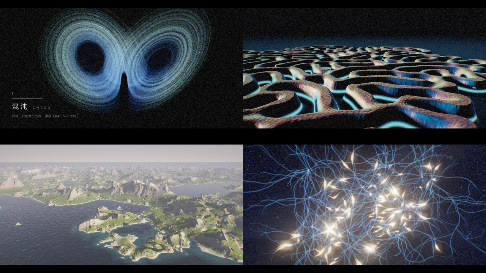
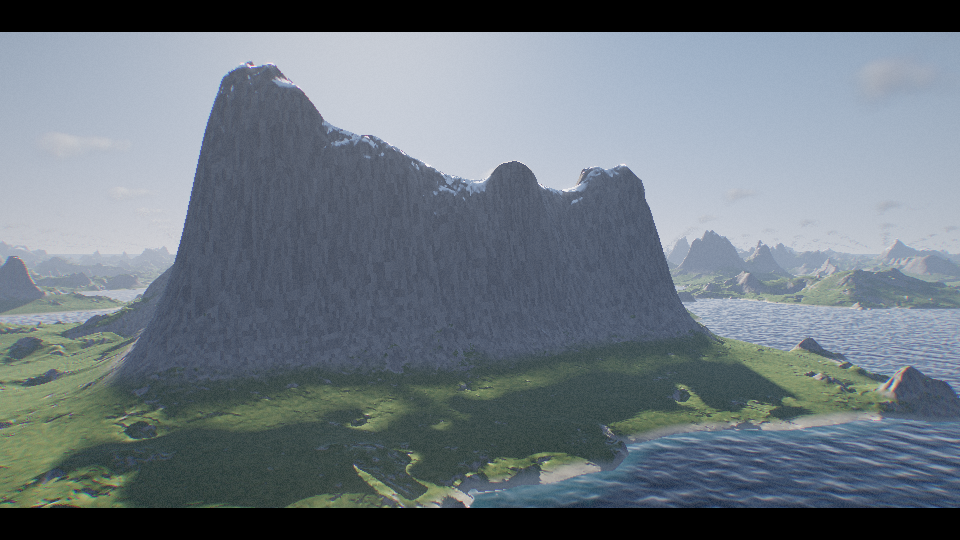
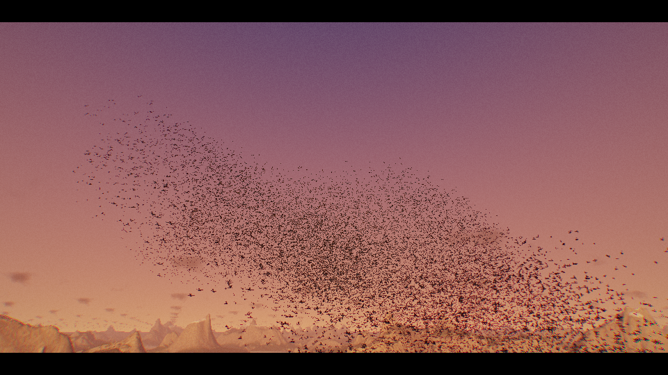
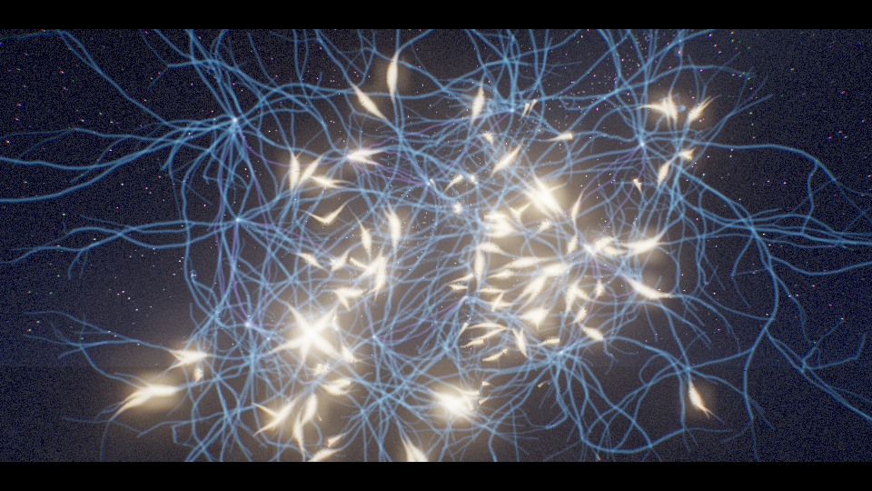

# 涌现 · Emergence



一段两分钟、可循环的视听短片，**没有用任何图片、模型或音频素材**：每一帧画面、每一个声音都在浏览器里由代码实时算出。
主题是「涌现」：从几条简单的规则里，长出越来越复杂的东西。

- **单文件：** [`emergence.html`](./emergence.html)，three.js 和全部着色器都内嵌在里面，离线也能打开。需要支持 WebGL 2 和浮点渲染目标的浏览器。
- 画质分高 / 中 / 低三档（手机默认低）；画面跟不上时会自动降低渲染分辨率来保住帧率。





## 五幕

| 时间 | 幕 | 画面 | 背后的规则 |
| --- | --- | --- | --- |
| 0:00 | 序 | 黑暗中一个随心跳明灭的点 | |
| 0:07 | Ⅰ 混沌 | 点炸开，100 万个粒子被洛伦兹、相泽（Aizawa）、哈尔沃森、托马斯四个奇异吸引子依次捕获、相互变形 | 每个吸引子只有三行微分方程，在 GPU 上逐帧积分（RK2） |
| 0:31 | Ⅱ 规则 | 粒子落到平面上，托马斯吸引子的六角星形影子成了种子，长出发光的珊瑚迷宫 | 格雷-斯科特反应扩散：每个像素只看周围八个邻居 |
| 0:50 | Ⅲ 世界 | 纹理隆起成山脉，海水填满低地，黎明；飞越湖泊、雪峰和云海 | 带解析导数的侵蚀噪声地形、水、体积云和大气，逐像素光线步进 |
| 1:12 | Ⅳ 生命 | 日落时数万只椋鸟在湖面上空聚散，镜头从鸟群中穿过 | 每只鸟在单位球里有固定位置，球被随时间拉伸、弯折、扫过密度波 |
| 1:31 | Ⅴ 心智 | 入夜，神经元从星光里生长、相连，信号沿树突与轴突传递 | 带分叉的随机生长；每一声钟响就是一次放电，沿轴突传到下一个神经元 |
| 1:50 | 尾声 | 网络碎成粒子，聚成「涌现」二字，再收缩回最初的那个点，循环 | |

## 操作

点「开始」播放（有声音）。移动鼠标或轻触屏幕会出现控制条：

- 播放 / 暂停（空格）、重播、拖动进度条，进度条上方是各幕的跳转点；`←` / `→` 跳 5 秒，`1`–`7` 跳到各幕
- 拖动画面可以转动视角（松手回弹）；在「混沌」一幕按住画面会搅动粒子
- 右上角是实时参数（分辨率、帧率、粒子数），`H` 开关；`M` 静音，`F` 全屏；画质下拉框切换高 / 中 / 低

## 怎么做的

| 文件 | |
| --- | --- |
| `src/timeline.js` `src/music.js` | 100 BPM、50 小节，正好 120 秒。乐谱是一张事件表，画面和声音都读它：粒子随底鼓明暗，反应扩散的发光纹路随节拍脉动，神经元按钟声放电。 |
| `src/attractors.js` `src/particles.js` | 四个吸引子先在 CPU 上积分一遍，求出中心、尺度和速度，统一到同一个世界坐标里。100 万个粒子的位置存在浮点纹理里，GPU 逐帧积分；粒子寿命到了就从吸引子的自然分布里重新取样，所以不会结块。变形时两个向量场按比例混合。 |
| `src/rd.js` | 512² 的格雷-斯科特模拟，参数随位置缓慢变化，一边是珊瑚、一边是更细的迷宫。种子是托马斯吸引子在地面上的投影，和粒子落下的位置一致。 |
| `src/terrain.js` `src/world.js` | 一个全屏着色器画出整个世界：反应扩散的浮雕（珠光材质、按节拍发光的脉络），隆起后的地形（整数哈希的侵蚀噪声，JS 里有一份完全相同的实现，用来检查镜头不会撞山），水面（菲涅尔反射、日光、岸边泡沫），软阴影，Perlin-Worley 三维噪声的体积云，天空、日月和星空。它同时写入深度，鸟群可以正确地飞在山前山后。 |
| `src/flock.js` | 鸟群完全无状态：位置是时间的函数，所以可以随意拖进度。离得太远的鸟会保持至少两个像素宽并相应变淡，而不是闪烁消失。 |
| `src/neurons.js` | 16 个神经元、约一万段树突和轴突，画成抗锯齿的屏幕空间条带。生长、信号传播、胞体闪光都在着色器里按时间计算。 |
| `src/audio.js` | 所有乐器都由振荡器和噪声合成：底鼓、拍手、镲、贝斯、超级锯齿琶音、铺底、带颤音的旋律、由元胞自动机（规则 90）生成节奏的马林巴、闪烁的拨弦、FM 钟声、上升音效与冲击声，加混响和乒乓延迟。现场播放用前瞻调度器，拖动进度时按新的时间重排。 |
| `src/post.js` | Bloom、曝光、ACES 色调映射、轻微色散、暗角、颗粒、宽银幕遮幅。 |

## 开发

```bash
npm install                # 在仓库根目录
npm run dev:emergence      # http://localhost:4194  （?q=high|medium|low 指定画质）
npm run build:emergence    # 重新生成 涌现/emergence.html
```

页面在 `window.__CAPTURE__ = true` 时隐藏开场和控制条，提供 `window.__app.renderAt(t)`（逐帧渲染任意时刻）和 `window.__app.renderAudio()`（离线渲染整段配乐，返回 WAV 的 base64），可以用来逐帧导出视频。
